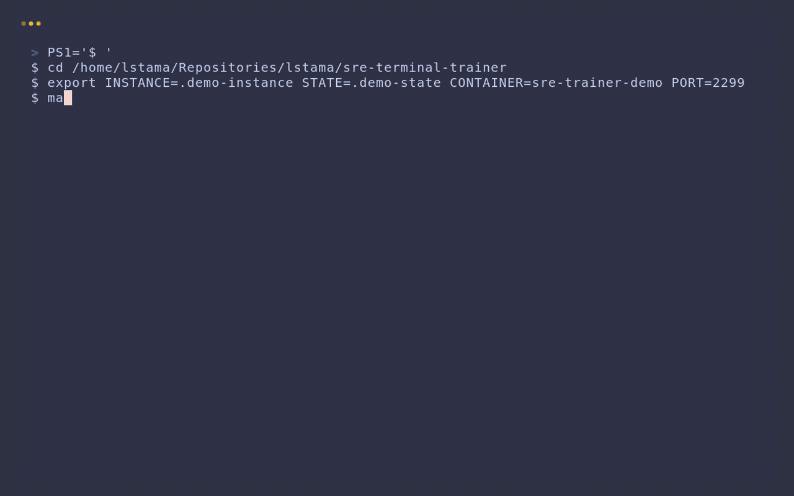

# sre-terminal-trainer

A disposable Docker **or Podman** container that drops you into a randomised set of **SRE
terminal drills** — log triage, config fixes, permission audits, editors, pipes, tmux — and
a small `verify` helper that checks your answers, hands out fragments, and turns them into
flags that unlock the next stage.

Everything runs locally. Nothing is sent anywhere.

> **Spoiler policy.** This README never describes a challenge or an answer. The answer
> key is generated inside the container *build* stage and is deleted before the runtime
> image is assembled: the image only ever contains hashes, so nothing in the repo or the
> image tells you what to type.

## What you get

- A container with `bash`, `tmux`, `nano`, `less`, `tree`, `grep`, `gawk`, `coreutils`,
  `diffutils` and `findutils` — the toolbox the drills expect, and nothing the trainee can
  use to escalate: no `sudo`, no compilers, no root access (the OpenSSH client is present
  only because sshd ships with it; no drill needs the network).
- A fresh, seeded set of challenges on every build: files under `/home/trainee` (yours to
  edit) and read-only inputs elsewhere.
- `verify` — a setuid helper that prints the current stage brief, hints, checks one answer
  at a time, awards the stage flag and keeps your elapsed time.
- `sshd` on port 22 inside the container, so you work over a real SSH session with a real
  password prompt.

## Requirements

- Docker (Linux or macOS; tested with Docker 29) **or** Podman (Linux; tested with Podman
  6.2 rootless; Podman 4 or newer). Nothing in the Makefile is specific to one of them, and
  rootless Podman needs no special setup beyond the usual `subuid`/`subgid` ranges.
- GNU `make` and `python3` on the host (used for random credentials and to summarise your
  records — nothing else).
- A free local port (default `2222`).

The container engine is auto-detected: **`podman` when it is on `PATH`, otherwise
`docker`**. Either engine can be forced per invocation:

```sh
make up                  # podman if installed, else docker
make up ENGINE=podman    # always podman
make up ENGINE=docker    # always docker
```

Every target honours `ENGINE` (it is exported to the recursive `make` calls of `new` and
`test`), so `make down ENGINE=docker` talks to the same engine that ran `make up`.

## Quick start

```sh
make up          # build the image, start the container, print seed/port/user/password
make ssh         # log in as the trainee (type the printed password)
```

Inside the session:

```sh
verify next      # show the current stage
verify status    # stage, elapsed time, checks done
verify hint      # this stage's hints (3 lines, then one per check), a page at a time
verify check <check-id> <answer>
verify stage     # once every check in the stage passes, earn the stage flag
verify unlock <flag>
verify --help    # the full command list
```

Finish the last stage, then use `verify finish <final-flag>`; the run is appended to the
completion log. Log out and run:

```sh
make down        # copy the completion log to state/records.jsonl, remove the container
make best        # your local runs, fastest first
```

Start a completely new challenge set with `make new` (down + fresh seed).

## Make targets

| Target | What it does |
|---|---|
| `make up [SEED=N] [SET=N] [PORT=N]` | Generate credentials if needed, build the image with `--build-arg SEED/SET`, start the container, print seed, port, credentials and the stage list. |
| `make ssh` | SSH to `127.0.0.1:$PORT` with host-key checking disabled (throwaway container) and the credentials from `.instance/creds`. |
| `make status` | Container state, credentials path, seed, port and saved records. |
| `make down` | Copy `/var/lib/sre-trainer/state/records.jsonl` into `state/`, then stop and remove the container. |
| `make new` | `down`, then `up` with a fresh random seed. |
| `make best` | Sort the saved records by elapsed time. |
| `make test` | One up/down cycle, then assert the working tree is still clean. |
| `make demo` | Re-record the demo (`docs/demo/sample-run.mp4` and `.gif`) with VHS. |
| `make demo-mp4`, `make demo-gif` | Re-record only one of the two demo files. |
| `make clean` | Remove the container, the image, `.instance/` and `state/`. |

Variables: `ENGINE` (`podman` or `docker`, auto-detected as described above), `IMAGE`,
`CONTAINER`, `PORT`, `SET` (stages per run, default 8), `SEED`, `SSH_USER`, `INSTANCE`
(where credentials go, default `.instance`) and `STATE` (where records go, default
`state/`). A given `SEED` always produces the same challenge set, so `make up SEED=1234`
replays a run; `make new` picks a new seed for you. `INSTANCE`/`STATE` are the escape
hatch used by the demo recorder, which keeps its own credentials and records in a
throwaway `.demo-instance/` and `.demo-state/` instead of overwriting yours.

## Local state

| Path | Contents | Committed? |
|---|---|---|
| `.instance/creds` | `SSH_USER`, `SSH_PASSWORD` (mode 0600) | no |
| `.instance/seed` | Seed of the last build | no |
| `state/records.jsonl` | Completion records copied out by `make down` | no |
| `.demo-instance/`, `.demo-state/` | Same, for the throwaway instance `make demo` records in | no |

Only sources, config and docs are tracked; see `.gitignore` and `.dockerignore`.

## How it fits together

```
host                          container build (builder stage)       runtime image
----                          -------------------------------       -------------
make up SEED=… SET=…   ───▶   generator/generate.py ──▶ /generated/  ──▶ challenges at their
                              src/verify.c ──▶ static binary           absolute paths
                                                                       /usr/local/bin/verify (4755)
                                                                       /var/lib/sre-trainer/{manifest,
                                                                         stages/, final.sha256, state/}
                                                                       sshd + entrypoint.sh
```

The image is built from the repository's `Dockerfile`; Podman's buildah reads the same file
and honours `.dockerignore` identically, so both engines produce the same image.

- `generator/generate.py` runs **only** at build time and writes the challenge files, the
  stage texts, the check definitions and the flag hashes. Its `--dump-answers` output is
  deleted inside the builder.
- `src/verify.c` is compiled static (`gcc -O2 -static`) and installed setuid root, because
  the stage texts, checks and progress all live in a root-only directory. It drops
  privileges while it parses your answers.
- `docker/entrypoint.sh` is the only script in the runtime image: it creates the trainee
  account from `SSH_USER`/`SSH_PASSWORD`, fixes ownership, and executes `sshd`.

## Walkthrough

A guided, spoiler-free walkthrough of a full run (from `make up` to the final flag) lives
at [docs/walkthrough.md](docs/walkthrough.md): the session mechanics, plus what each drill
teaches and how to approach it without giving any answers away.

## Demo



That recording is a real session against a real container — nothing is typed by hand, staged
or faked. It shows one stage end to end: `make up`, `make ssh` with the generated password,
`verify next`, the `grep` work the brief actually asks for, the three `verify check`
submissions, `verify stage`, `verify unlock <flag>` (which prints the next stage's brief) and
`make down`. A higher-quality copy is
[docs/demo/sample-run.mp4](docs/demo/sample-run.mp4).

The recordings are committed, so **VHS is only needed to regenerate them**:

```sh
make demo       # rewrite docs/demo/sample-run.{mp4,gif}
make demo-mp4   # only the MP4
make demo-gif   # only the GIF
```

Regenerating needs [VHS](https://github.com/charmbracelet/vhs) and `ffmpeg` (which VHS itself
uses), plus `gifsicle` if it is installed, to shrink the GIF. `demo/render.sh` drives it:

- it regenerates the answer key for a fixed seed on the host and asserts that stage 1 is
  `deploy-error`, a quick grep drill (`SEED=…` selects a different one);
- it warms the image cache first, then records a real `make up`;
- it runs on a throwaway instance — `.demo-instance/`, `.demo-state/`, container
  `sre-trainer-demo`, port 2299 — so your own credentials, records and container are never
  touched, and it removes that instance whether the recording succeeds or fails;
- it fills `demo/sample.tape` in with the generated log path, check ids, answers and stage
  flag, and runs VHS from a scratch directory.

`demo/style.tape` holds every presentation setting (theme, font size, window bar, margin,
framerate), so the look can be swapped without touching the run; `demo/sample.tape` is the
sequence. The password in the video belongs to the demo container and is thrown away with it.

## Troubleshooting

- **`port is already in use`** — pick another host port: `make up PORT=2223`.
- **`permission denied` talking to Docker** — your user is not in the `docker` group.
- **`permission denied` talking to Podman** — rootless Podman refuses to map container
  users when the host has no `subuid`/`subgid` ranges for you; check with `podman unshare
  id`, then add `<user>:100000:65536` to `/etc/subuid` and `/etc/subgid` and run `podman
  system migrate` once.
- **Podman says `unauthorized: incorrect username or password` while pulling** — a stale
  Docker Hub login in `~/.docker/config.json` (Docker silently falls back to an anonymous
  pull, Podman does not). Run `podman login docker.io`, remove the stale entry from that
  file, or point `REGISTRY_AUTH_FILE` at an empty auth file.
- **`no container named …` after switching engines** — `make down`/`make status`/`make
  clean` only see the engine they talk to; add `ENGINE=docker` or `ENGINE=podman` to match
  the engine that started the container.
- **Container exits immediately** — `make up` prints the last log lines; the entrypoint
  refuses to start without `SSH_PASSWORD`.
- **Want the challenge set back after editing files** — `make down && make up` rebuilds a
  pristine container (same seed unless you pass a new one).

## Security note

Password authentication with a throwaway container is deliberate: it keeps the session
realistic. `make up` publishes the port on `127.0.0.1` only (loopback), so the sshd is not
reachable from the network; keep it that way, and do not reuse `.instance/creds` anywhere
else. The publish is identical for both engines, including rootless Podman, where the
forwarder runs as your own user.

## License

MIT — see [LICENSE](LICENSE).
