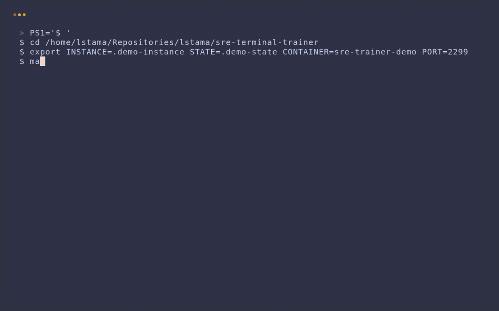
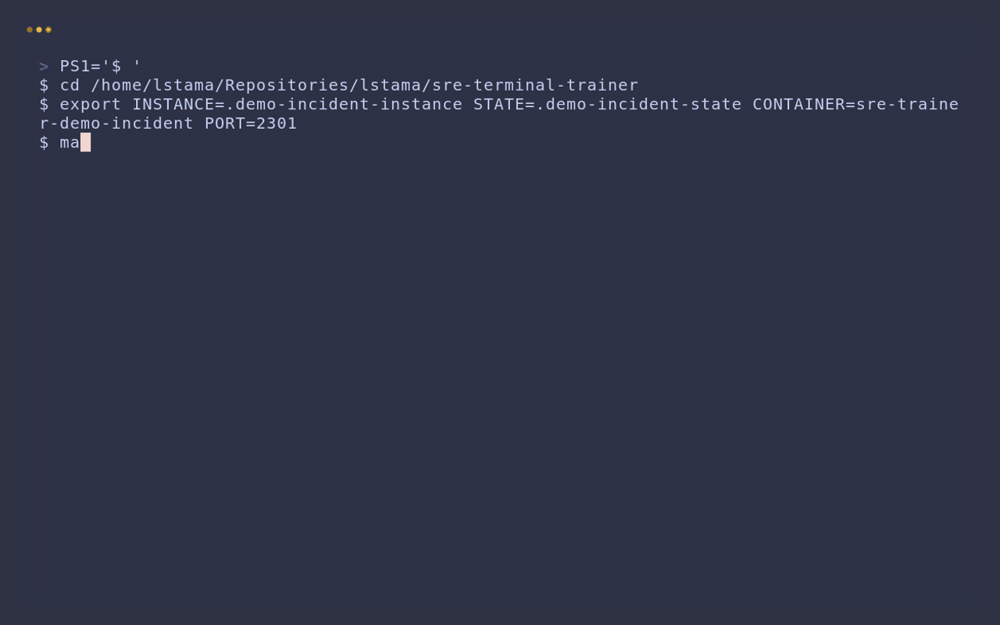

# Reproducing the demos

The GIFs and MP4s committed in this directory are real, unscripted sessions
against real containers — nothing is typed for effect. This page covers how to
re-record them; you only need it to regenerate the assets.

## Terminal mode demo



[Watch the full Terminal mode video (MP4)](sample-run.mp4)

## Incident mode demo



[Watch the full Incident mode video (MP4)](incident-run.mp4)

This one runs `MODE=incident PICK=k8s-crashloop`: a single Kubernetes
CrashLoopBackOff incident. The recording shows the real build and start, the
real ssh login, the stage brief, two mocked `kubectl` diagnostics
(`kubectl get po` and `kubectl logs <pod>`), the two hash answers, the
one-line manifest repair and its file check, `verify stage` awarding the flag,
and `verify unlock` printing the next instruction. Because the pick contains
one stage, that instruction is the final-flag step, made explicit by a
following `verify next`, and the session ends with `exit` and `make down`.

## Re-record

```sh
make demo           # rewrite docs/demo/sample-run.mp4 and .gif (Terminal mode)
make demo-mp4       # only the Terminal mode MP4
make demo-gif       # only the Terminal mode GIF
make demo-incident  # rewrite docs/demo/incident-run.mp4 and .gif (Incident mode)
```

Requires [VHS](https://github.com/charmbracelet/vhs) and `ffmpeg` (which VHS
uses), plus `gifsicle` if installed to shrink the GIF. The recordings are
committed, so none of this is needed just to run the trainer.

## How a recording is made

Both recorders drive the real harness against throwaway instances so your own
`.instance/`, `state/` and container are never touched:

- [`demo/render.sh`](../../demo/render.sh) regenerates the Terminal answer key
  for a fixed `SEED` (default `8`), asserts stage 1 is `deploy-error`, warms the
  image cache, then records a real `make up` and a full attempt. Its scratch
  instance is `.demo-instance/`, `.demo-state/`, container `sre-trainer-demo`,
  port `2299`. `SEED=…` selects another seed.
- [`demo/render-incident.sh`](../../demo/render-incident.sh) does the same for
  `MODE=incident PICK=k8s-crashloop` with a fixed `SEED` (default `8`), using
  its own `.demo-incident-instance/`, `.demo-incident-state/`, container
  `sre-trainer-demo-incident` and port `2301`, so it cannot collide with the
  Terminal recording. Both tapes share [`demo/style.tape`](../../demo/style.tape)
  for presentation settings.

Each recorder fills its tape template with generated tokens (the log path for
Terminal; pod name, config keys, check ids, answers and stage flag for
Incident), then runs VHS from a scratch directory. The template
itself (`demo/sample.tape` or `demo/incident.tape`) contains only real commands:
VHS 0.12.1's `Wait+Screen` matches only the first screenful, so the tapes use
plain prompt `Wait` gates with short lead-in sleeps, and `Hide`/`Show` cover
only the setup plumbing. A cleanup trap removes the throwaway container and
its credentials whether recording succeeds or fails.

The passwords typed on screen belong only to the throwaway demo containers and
are discarded with them. For setup and usage, see the
[main README](../../README.md).
